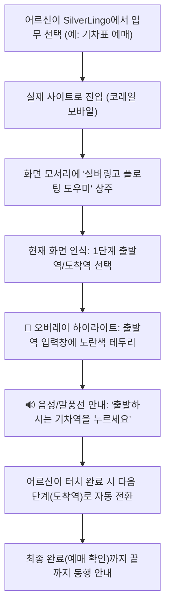

# SilverLingo 아이디어 및 설계 정리

> 기획 단계에서 나온 아이디어와 설계 내용을 주제별로 정리한 참고 문서입니다.
> 대화 흐름은 [conversation_log.md](./conversation_log.md), 확정된 결정 사항은 [../AGENTS.md](../AGENTS.md)를 참고하세요.
> 현재 유효한 내용만 남겨 두었습니다. 바뀜어서 없어진 내용은 지웠습니다.

---

## 1. 가능한지 검토한 결과

## 1. 프로젝트 핵심 방향 (피벗 확정)

### 1-1. 피벗 배경 (완전 자동화 제외)
- 초기에는 시스템이 사이트에 직접 들어가 대신 입력하는 '완전 자동화(RPA)'를 함께 고려했으나, 팀원 논의 결과 **프로젝트 범위(캔버스)가 지나치게 방대해지고 유지보수 및 법적 리스크가 가중**되는 문제가 확인됨.
- 따라서 완전 자동화(서버 대리 입력)는 완전히 제외하고, **'서드파티 플로팅 오버레이 동행 도우미(Overlay Companion)' 단일 모델에 100% 집중**하기로 확정.

### 1-2. 서드파티 플로팅 오버레이 도우미란?
- **형태**: 스마트폰 화면 한쪽에 작은 위젯(플로팅 버블 / 미니 가이드 바) 형태로 상시 상주.
- **동작**: 어르신이 앱을 통해 카카오 T, 코레일, 똑닥 등의 실제 모바일 사이트/앱에 진입했을 때:
  1. **입력 위치 스포트라이트 (오버레이)**: 화면에서 지금 입력하거나 터치해야 할 버튼/입력창을 하이라이트 박스로 짚어줌.
  2. **친절한 한글 설명 & 음성 (Co-pilot)**: 행정 용어 대신 쉬운 일상어로 "여기에 생년월일을 적으세요", "파란색 발급신청 버튼을 누르세요"라고 말풍선과 🔊 음성으로 안내.
  3. **주도적 완료**: 어르신이 스스로 단계별로 터치하며 안심하고 업무를 완료할 수 있도록 끝까지 1:1로 동행.

### 1-3. 법적·보안적 이점 (상용화 100% 보장)
| 항목 | 기존 완전 자동화 방식 | 서드파티 오버레이 도우미 방식 (확정) |
|---|---|---|
| 개인정보 처리 | 주민번호, 비밀번호 등을 시스템이 입력 | **사용자가 직접 입력하므로 서버/앱에 일체 저장 안 함** (법적 이슈 0%) |
| 전자금융거래법 | 대리 접속/접근매체 대여 소지 | **본인이 직접 조작하므로 합법성 100%** |
| 사이트 보안 프로그램 | TouchEn, 가상 키패드 충돌로 자동화 불가 | **어르신이 직접 가상 키패드를 터치하므로 정상 동작** |
| 피싱 예방 | - | 실제 공식 사이트 도메인(`gov.kr`, `letskorail.com`) 검증 오버레이 제공 |

---

## 2. 지원 대상 업무 및 오버레이 시나리오

어르신들이 실생활에서 가장 어려움을 겪는 대표 온라인 업무를 선정하여 단계별 오버레이 가이드 제공:

### 2-1. 핵심 지원 업무
1. **카카오 T 어르신 안심 택시 호출 (핵심 1순위)**:
   - 메인 [택시] 버튼 ➔ [어디로 갈까요/도착지 검색] ➔ [일반호출 / 기사님 직접 결제] ➔ [호출하기] (보안 백신 제약 없이 에뮬레이터/실기기 100% 동작, 무인증 발표 시연 모드 완비)
2. **코레일 기차표 예매 (코레일톡 / 모바일 웹)**:
   - 출발역·도착역 선택 ➔ 날짜 및 시간 선택 ➔ 열차 조회 ➔ 예매 버튼 ➔ 좌석 선택 ➔ 결제하기 (인앱 브라우저 동행 + 간편인증 완비)
3. **병원 안심 당일 접수 (똑닥 DDocDoc — 핵심 3순위, 실생활 소외 1위)**:
   - [🏥 병원 찾기 / 진료과] ➔ [🩺 진료 접수하기] ➔ [👤 본인 선택] ➔ [✅ 접수 완료]
   - *배경*: 동네 병원의 모바일 현장접수 마감으로 인한 어르신 진료 거부/헛걸음 사회적 문제 해결
   - *특징*: 금융/보안 백신(TouchEn) 0개로 100% 정상 작동, 공식 앱 연동 다이얼로그 + 인앱 브라우저 실제 사이트 동행(`CompanionBrowserActivity`) 완비
4. **보안 프로그램 프리(Free) 추가 후보군**:
   - **고속·시외버스 예매 (티머니GO / 버스타고)**: 터미널 창구 축소 대응 교통 패키지
   - **카카오톡/네이버 전자증명서 (주민등록등본)**: 정부24 앱 백신을 우회하는 카카오톡 지갑 기반 서류 발급
   - **무거운 짐 안심 방문택배 (CJ대한통운 / 카카오페이 배송)**: 관절 보호 문 앞 수거
   - **따뜻한 한 끼 배달 (배달의민족)**: 카드 등록 없는 "기사님께 직접 결제" 배달 주문

---

## 3. 오버레이 도우미의 인터랙션 메커니즘

### 3-1. 시각적 안내 (오버레이 하이라이트)
- **스포트라이트 / 포커스 링**: 현재 터치해야 할 요소의 테두리에 굵은 하이라이트(노란색/파란색 고대비) 애니메이션 표시.
- **말풍선 안내**: 타깃 요소 바로 위 또는 아래에 큰 글씨(20px 이상)로 행동 지침 표시.
- **손가락 아이콘 / 애니메이션**: 누르는 방향을 직접 가리키는 핑거 포인터 제공.

### 3-2. 청각적 안내 (TTS 음성 동행)
- 각 단계 진입 시 어르신이 읽지 않아도 귀로 들을 수 있는 친절한 음성 설명 자동 재생.
- "다시 듣기" 버튼을 플로팅 바에 항시 배치.

---

## 4. 실제 사이트 직접 주입 오버레이 엔진 (Direct Injected Overlay Engine)

### 4-1. 기본 원칙 (가짜 시뮬레이터 배제)
- 모달 내 가짜 모의 연습 화면을 전면 배제하고, **실제 관공서 공식 웹사이트(코레일 `letskorail.com` 등)**에 사용자가 직접 접속하여 업무를 처리하도록 지원.
- 브라우저 확장 프로그램(Manifest V3) 또는 안드로이드 시스템 오버레이(`SYSTEM_ALERT_WINDOW`)를 통해 실제 사이트 DOM/화면 위에 **'여기를 누르세요' 포커스 링과 쉬운 말풍선**을 직접 실시간 주입.

### 4-2. 버튼 가림 100% 원천 차단 설계 (Anti-Occlusion Architecture)
1. **스마트 위치 계산 엔진 (Smart Placement)**:
   - 타깃 버튼의 위치와 크기, 툴팁 크기를 실시간 측정하여 타깃과 절대 겹치지 않는 **외곽 20px 안전 여백**에 배치.
   - 상단 공간이 충분할 경우: 버튼 상단 20px 위 + 아래 방향 꼬리표 (▼)
   - 상단 공간 부족 시: 버튼 하단 20px 아래 + 위 방향 꼬리표 (▲)
2. **클릭 관통 및 위임 (Click-Through Delegation)**:
   - 노란색 스포트라이트 링: `pointer-events: none !important;`로 마우스/터치 클릭 100% 관통.
   - 말풍선 툴팁: 어르신이 말풍선을 눌러도 타깃 버튼의 클릭 이벤트가 즉시 발동하도록 클릭 위임 연결.
3. **위치 비키기 및 최소화**:
   - `[↕ 위치 비키기]` 버튼으로 툴팁을 상/하 반대편으로 즉시 이동 가능.
   - 우하단 플로팅 바는 하단 버튼과 충돌 시 **화면 상단으로 자동 대피(`dock-top`)** 및 **작은 아이콘으로 접는 최소화(`—`)** 지원.

### 4-3. 진행 단계 자동 이동 파이프라인 (Auto-Advance State Machine)
> ❌ 정부24 4단계 파이프라인은 대화 46에서 삭제됨. 현재는 코레일(열차조회 ➔ 예매) 단계 엔진만 유지.
- 수동 단계 넘김 없이, 사용자가 버튼을 클릭하거나 화면이 전환되면 **URL과 DOM을 실시간 감지하여 다음 단계로 척척 자동 이동**:

### 4-4. 스마트 로그인/인증 감지 & 안심 도우미 인터럽트 (Smart Auth-Interruption & Recovery)
- **도입 배경**: 어르신들이 온라인 업무 중 갑자기 로그인/인증 화면으로 튕기면 "내가 잘못 눌렀나?" 하고 당황하여 이탈하는 문제가 가장 빈번함.
- **동작 메커니즘**:
  1. **실시간 감지**: URL(`login`, `sso`, `auth`, `cert` 등) 및 DOM(비밀번호창, "로그인", "본인확인", "간편인증") 감지.
  2. **업무 일시 중단 & 안심 케어**:
     - `🛡️ 본인인증(로그인) 도우미` 파란색 전용 안심 뱃지 노출.
     - "안심하세요! 서류를 신청하기 위해 본인인지 확인하는 화면입니다. 아이디나 비밀번호를 모르셔도 괜찮으니 [카카오톡 간편인증]이나 [비회원 신청]을 눌러주세요." 음성 및 말풍선 안내.
  3. **인증 통과 후 자동 복귀**:
     - 본인 확인이 끝나면 🔊 "본인 확인이 완료되었습니다! 계속해서 서류 신청을 도와드릴게요" 음성과 함께 원래 신청서 작성 단계로 매끄럽게 자동 복귀.

---

## 5. 모바일 중심 설계 기준

### 5-1. 화면 기준
| 항목 | 일반 앱 | SilverLingo |
|---|---|---|
| 기본 글자 | 14~16px | **20px 이상**, 제목 28px 이상 |
| 버튼 | 44px | **56~64px 높이**, 화면 너비에 꽉 차게 |
| 대비 | 4.5:1 | **7:1 이상** (WCAG AAA) |
| 정보량 | 여러 기능 | **한 화면에 한 가지 일** |
| 메뉴 | 햄버거 메뉴 | **사용 금지**, 큰 타일 메뉴 |
| 아이콘 | 아이콘만 | **아이콘 + 글자** |
| 손동작 | 밀기, 길게 누르기, 확대 | **누르기만** |
| 시간 제한 | 자동으로 사라지는 알림 | **자동으로 사라지지 않음** |
| 주요 버튼 | 다양 | **화면 아래 고정** |

### 5-2. 입력 부담 줄이기
- 음성 입력 (Web Speech API)
- 모든 화면에 🔊 음성 읽어주기
- 숫자는 숫자 키패드만 (`inputmode="numeric"`)
- 타이핑 대신 큰 버튼 중에서 고르기
- 글자 크기 조절 (`가 가 가`)
- 중요한 동작 전 확인 창, 큰 뒤로 가기 버튼

### 5-3. 기능별 모바일 적용 방식
| 기능 | 방식 |
|---|---|
| 시뮬레이터 | 은행 앱 화면으로 캡처 |
| 클릭 영역 | 비율 좌표 사용 |
| 실전 모드 | 폰 한 대 기준: 음성 안내⭐, 안내 카드 저장, 가족 공유 |
| 본인인증 연습 | 같은 폰 안에서 앱을 전환하는 과정 재현 |
| 자동화 데모 | 엔진은 서버에서 실행, 폰에는 진행 화면만 실시간 표시 |

### 5-4. 기술
- 360~412px(갤럭시 A 시리즈) 기준 모바일 우선 CSS
- **PWA**: 홈 화면에 앱처럼 설치
- PC에서는 가운데 최대 480px로 표시
- 테스트: Chrome 개발자 도구 기기 모드 + 실제 휴대폰

### 5-5. 발표 팁
- Smart View나 scrcpy로 실제 폰 화면을 프로젝터에 띄우기
- 또는 PC 화면에 휴대폰 모양 틀 씌우기

---

## 6. 기술 스택 (서드파티 오버레이 도우미)

| 구성 요소 | 기술 | 역할 |
|---|---|---|
| 클라이언트 (공식 네이티브 앱) | **Kotlin 2.0 + Jetpack Compose (`android/`)** | `MainActivity`(대형 카드 대시보드), `FloatingCompanionService`(`SYSTEM_ALERT_WINDOW` 플로팅 위젯), `SilverAccessibilityService`(화면 버튼 실시간 탐색 및 노란색 링 주입) |
| 백엔드 | **Java 24 + Spring Boot (Gradle)** | 사이트별 가이드 메타데이터/규칙 JSON 서빙, 지원 사이트 규칙 관리, 헬스체크 (`/api/health`) |
| 클라이언트 (웹 확장 프로그램) | **Chrome Extension (Manifest V3)** | `content.js` + `overlay.css`: 실제 사이트(코레일) 웹 DOM에 직접 포커스 링, 스마트 말풍선 주입 |
| 클라이언트 (웹 대시보드 데모) | HTML5 + Vanilla CSS + JavaScript | 모바일 기준(360~480px) 중앙 뷰어, 사용자 온디바이스 프로필 관리, 서비스 바로가기 |
| 음성 안내 (TTS/STT) | Android TextToSpeech / Web Speech API | 어르신을 위한 1:1 친절한 음성 설명 제공 |
| 저장소 | 온디바이스 로컬 저장소 (`EncryptedSharedPreferences` / `localStorage`) | 어르신 기본 인적사항 기기 내 암호화 보관 (서버 무저장 원칙) |

> 참고: 복잡하고 깨지기 쉬운 브라우저 RPA(Playwright 대리 조작)를 완전히 배제함으로써 시스템의 안정성과 유지보수성이 대폭 향상되었습니다.

---

## 7. 즉시 상용화 전환 로드맵 (Production-Ready Architecture)

발표 데모에서 끝나는 것이 아니라, **조금만 추가 개발했을 때 구글 플레이스토어 및 실서비스로 즉시 출시**할 수 있도록 다음 핵심 아키텍처를 적용합니다.

### 7-1. 서버 무저장 온디바이스 보안 (Zero-Knowledge Architecture)
- **법적 규제 완벽 해결**: 어르신이 직접 사이트에 입력하므로 서버가 대리 인증/로그인을 하지 않으며, 인적사항은 오직 기기 로컬 암호화 영역(`androidx.security.crypto.EncryptedSharedPreferences`)에만 저장.
- **장점**: ISMS 인증이나 개인정보 관리체계 심사 없이도 개인정보보호법 및 전자금융거래법을 100% 준수하며 즉시 상용 앱으로 배포 가능.

### 7-2. 안드로이드 시스템 오버레이 상용화 (Android System Alert Window + AccessibilityService)
- **`FloatingCompanionService`**: 화면 상시 상주 미니 플로팅 버블. 사용자가 어느 앱/웹 브라우저를 띄우든 화면 모서리에 위치하며, 터치 드래그로 위치를 옮기거나 클릭 시 가이드 말풍선과 TTS 음성을 제공.
- **`SilverAccessibilityService`**: 화면의 윈도우 콘텐츠 및 뷰 노드 변화(`TYPE_WINDOW_CONTENT_CHANGED`, `TYPE_VIEW_CLICKED`)를 감지하여 타깃 텍스트("열차조회", "실시간 접수", "호출하기" 등)가 보이면 그 즉시 해당 노드의 화면 절대 좌표에 노란색 펄스 링과 쉬운 말풍선을 자동 렌더링.

---

## 8. 확정된 지원 업무 및 앞으로 진행할 사항
| 항목 | 상태 | 내용 |
|---|---|---|
| 공식 클라이언트 플랫폼 | **확정 완료** | **Android 네이티브 (Kotlin 2.0 + Jetpack Compose, `android/`)** |
| 첫 번째 오버레이 지원 대상 | **구현 완료** | **카카오 T 어르신 안심 택시 호출** (안심 발표 시연 모드 `KakaoTaxiDemoActivity` 완비, 실제 기기 카카오 T 공식 앱 실시간 노드 감지 연동) |
| 두 번째 오버레이 지원 대상 | **구현 완료** | **코레일 기차표 예매** (메인 ➔ 열차조회 ➔ 예매하기 및 카카오 간편인증 연동 완료) |
| 세 번째 오버레이 지원 대상 | **구현 완료** | **병원 안심 당일 접수 (똑닥 DDocDoc)** (병원 찾기 ➔ 접수하기 ➔ 본인 선택 ➔ 접수 신청 완료, 공식 앱 연동 다이얼로그 및 웹 동행 오버레이 완비) |
| 온디바이스 로컬 저장소 | **구현 완료** | `EncryptedSharedPreferences` 기반 이름, 생년월일, 주소, 계좌 암호화 저장 |
| 실제 스마트폰 실기기 검수 파이프라인 | **구현 완료** | **원클릭 자동 검수 스크립트(`스마트폰_원클릭_검수.bat`) 및 바탕화면 실기기 검수용 최신 APK 배포 완비** (USB 연결 시 SilverLingo + 똑닥 11.13.0 자동 설치 및 권한 화면 자동 호출) |
| 추가 후보군 (보안 프로그램 프리) | 계획 | 고속·시외버스 예매(티머니GO), 카카오톡 전자증명서(등본), 방문택배 접수, 배달의민족 |
| 팀원 4명 역할 분담 | 미정 | 백엔드 API / Compose 대시보드 / 접근성 오버레이 엔진 / 시나리오 메타데이터 분담 예정 |

---

## 9. 개발 및 테스트 애로사항과 해결 가이드 (Troubleshooting & Gotchas)

### 9-1. 관공서 앱 보안 백신(TouchEn mVaccine) 충돌
* **문제 현상**: 정부24 공식 앱 실행 시 에뮬레이터(AVD)에서 즉시 강제 종료(`DeadObjectException`).
* **원인**: 관공서/금융 앱 전용 강제 보안 백신이 가상머신/루팅 환경을 불법 환경으로 간주하여 프로세스 종료.
* **해결책**: 백신 제약이 없고 어르신 디지털 장벽이 높은 **실생활 밀착형 앱(카카오 T 택시 호출, 똑닥 병원 접수, 코레일)**으로 핵심 지원 업무를 전격 피벗.

### 9-2. 발표 환경 계정 인증 및 오결제 리스크
* **문제 현상**: 카카오 T 등 실제 모빌리티 앱은 SMS 본인인증이 필수이며, 발표 중 실수로 실제 택시가 호출되는 대형 사고 위험 존재.
* **해결책**: 실버링고 앱 내부에 실제 카카오 T와 동일한 UI의 **[안심 발표 시연 모드(`KakaoTaxiDemoActivity`)]**를 구축하여 무인증 4단계 100% 안전 시연 확보. 실기기 출시 시에만 실제 앱과 연동하도록 분리.

### 9-3. 구글 플레이스토어 국가 제한
* **문제 현상**: 에뮬레이터에서 똑닥 등 한국 전용 앱 검색 시 "거주 국가에서 사용할 수 없습니다" 표시.
* **원인**: 에뮬레이터 시스템 기본 로케일(`en-US`) 및 구글 계정 프로필 국가가 해외로 설정됨.
* **해결책**: 
  1. `am start -a android.settings.LOCALE_SETTINGS`로 한국어 언어 추가.
  2. 계정 국가 변경 대신 신뢰할 수 있는 소스에서 최신 APK를 다운받아 드래그&드롭 또는 `adb install`로 1초 만에 설치.

### 9-4. React Native 기반 앱(똑닥 등)의 CPU 아키텍처 불일치 (ABI Mismatch)
* **문제 현상**: 에뮬레이터에 똑닥 APK 설치 후 실행 시 `com.facebook.soloader.SoLoaderDSONotFoundError: couldn't find DSO to load: libreactnative.so` 에러와 함께 크래시 발생.
* **원인**: PC 에뮬레이터 CPU는 **`x86_64` (인텔/AMD)**인 반면, 다운로드된 모바일 APK가 스마트폰 전용인 **`arm64-v8a`** 네이티브 라이브러리만 포함하고 있어 발생. (정부24 백신 이슈와 무관)
* **실기기 호환성**: 모든 실제 안드로이드 스마트폰(삼성 갤럭시 등)은 ARM64이므로 실기기에서는 100% 정상 구동.
* **에뮬레이터 즉시 테스트 해결책**: 실버링고 대시보드의 **`[🌐 인터넷 화면으로 계속하기 (웹 동행)]`** 모드를 통해 인앱 브라우저(`CompanionBrowserActivity`)로 실제 똑닥 모바일 웹(`ddocdoc.com`)과 4단계 실시간 오버레이를 100% 안정적으로 테스트 가능.

### 9-5. Android App Bundle 분할 APK (`INSTALL_FAILED_MISSING_SPLIT`)
* **문제 현상**: 최신 배포본 똑닥 APK 단독 설치 시 `INSTALL_FAILED_MISSING_SPLIT: Missing split for com.bbros.sayup` 에러 발생.
* **원인**: Google Play AAB(Android App Bundle) 정책으로 인해 리소스(언어, 해상도, CPU ABI)가 여러 split APK로 분할되어 배포됨.
* **해결책**: 
  1. 전체 XAPK 번들을 다운로드하여 분할 APK 추출(`c:\SilverLingooooo\apk\ddocdoc_v11.13.0_splits\`).
  2. `adb install-multiple -r base.apk config.arm64_v8a.apk config.en.apk config.xxhdpi.apk` 명령어로 모든 split을 한 번에 원자적(Atomic) 설치.

### 9-6. 구버전 클라이언트 업데이트 강제 팝업 방지
* **문제 현상**: 구버전 APK(v4.1.0) 실행 시 서버에서 지속적으로 "새로운 버전이 있습니다. 업데이트 하시겠습니까?" 다이얼로그 노출.
* **해결책**: 에뮬레이터 환경에서는 인앱 브라우저 **[🌐 인터넷 화면으로 열기 (웹 동행 모드)]**를 사용하여 업데이트 팝업 및 크래시가 0%인 상태에서 2026년 최신 공식 똑닥 모바일 서비스(`ddocdoc.com`)와 1:1 오버레이 동행 검증.

### 9-7. 스마트폰 실기기 즉시 검수 파이프라인
* **배경**: 에뮬레이터(x86_64) 기반 검증 완료 후, 실제 스마트폰(ARM64) 실기기에서 카카오 T 및 똑닥 공식 앱과 접근성 서비스 연동을 검수하기 위한 절차 간소화 필요.
* **솔루션**:
  1. **바탕화면 원클릭 배치(`스마트폰_원클릭_검수.bat`)**: USB 연결 감지, SilverLingo 최신 빌드 자동 설치, 똑닥 Split APK 4종 원자적 설치, 권한 설정(화면 오버레이, 접근성) 화면 자동 팝업 및 앱 실행을 1클릭 자동화.
  2. **바탕화면 무선 배포 APK(`SilverLingo_스마트폰_검수용.apk`)**: 케이블 연결 없이 카카오톡/드라이브로 전송하여 원터치 설치 및 검수 지원.

