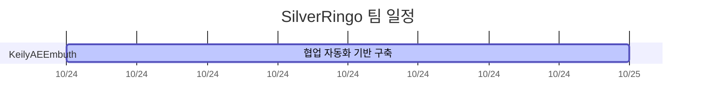

# 팀 일정

자동 생성: `automation/schedule.json`을 수정한 뒤 `python automation/check.py --write-schedule`을 실행하세요.

날짜는 달력 일수 기준입니다. 의존 작업 종료 전 시작하는 일정과 순환 의존은 검사에 실패합니다.

담당·일정 합의는 Discord에서 진행하며, 이 표에는 시각화할 작업만 등록합니다.

| 작업 | 담당 | 선행 작업 |
|---|---|---|
| automation_bootstrap | KeilyAEEmbuth | - |
