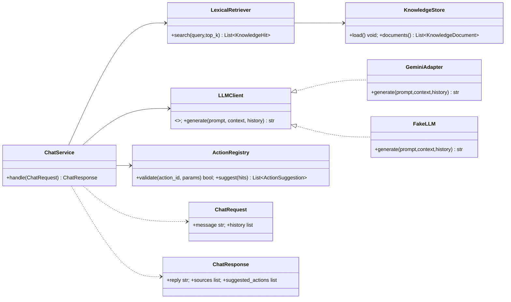
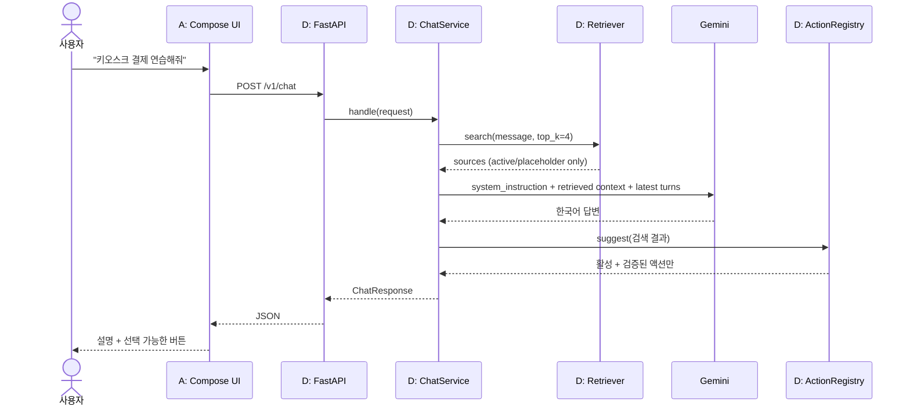
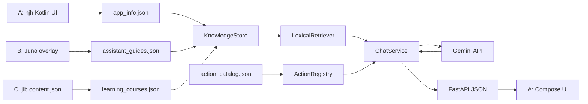

# D파트 Chat & Knowledge Engine — 전체 계획 / 아키텍처 v0.1

## 0. 프로젝트 맥락
- A `hjh`: Kotlin + Jetpack Compose UI, 현재 홈 `IT 기능 배우기`·`생활 가이드` 진입 콜백. AI 채팅은 안내만 있는 스텁.
- B `Juno`: 똑닥(`com.bbros.sayup`) 병원 접수 오버레이/음성 안내와 웹 대체 화면. 과거 회의의 카카오T·코레일 등은 현행 지원으로 단정 금지.
- C `jib`: 키오스크 코스 1개, 6레벨. JSON 지식 및 `LearningEntry(onExit,onResult)` 연동 포인트; 레벨 잠금 판정은 C가 소유.
- D `ydy_workspace`: 공통 `Tester/`만 있으며 D 백엔드는 아직 없음. `main`에는 A/B/C 기능이 아직 통합되지 않았음.

## 1. 목표와 범위
목표: 사용자의 짧은 한국어 질의 → 프로젝트 지식 검색 → 안전하고 쉬운 한국어 답변 → 검증된 UI 기능 제안(JSON) → Android UI가 처리. 서버가 직접 외부 앱을 클릭/접수하지 않는다.

필수: 4 JSON, 검증 가능한 로더, 키워드/유의어 검색, Gemini 답변 어댑터, 실행허용 목록, ChatService, FastAPI, 테스트 및 Team Sync 통합 계획.
비범위: 음성인식, Android 채팅 UI 제작, RPA, 브라우저 DOM 제어, 실결제/실접수, 사용자 계정 DB, 벡터 DB, 임베딩 필수화, 스트리밍, 배포 자동화.

## 2. 책임 분리
- `app_info.json`: 앱 소개, 메뉴 구성/상태. A 원본.
- `learning_courses.json`: C 코스/레벨 및 설명, 잠금 규칙.
- `assistant_guides.json`: B 안내 서비스, 단계 및 필요 권한, 구현 범위.
- `action_catalog.json`: **실행 가능 액션의 검증 레지스트리**. 답변용 지식과 별도로, A/B/C 계약에 연결된 ID·필요조건·활성화 상태 관리.
- `KnowledgeStore`: JSON 파싱, 스키마/교차 참조 검증, 원자적 리로드(실패 시 마지막 유효 스냅샷 유지).
- `Retriever`: 공통 KnowledgeDocument 집합 검색. M02는 결정적 lexical + aliases. M08 선택적 임베딩.
- `GeminiAdapter`: 시스템 지침, 선택된 검색 문맥, 최근 대화를 SDK로 전달; 텍스트 생성만.
- `ActionRegistry`: 등록·활성 액션만 필터링하고 파라미터 검증. LLM이 제시한 임의 ID/URL 실행 금지.
- `ChatService`: 요청 검증 → 검색 → 프롬프트 구성 → 생성 → 레지스트리 검증 → 응답. 검색 실패면 확인 가능 범위만 안내.
- `FastAPI`: POST /v1/chat, GET /health, GET /v1/catalog(선택적 읽기 전용). API 키는 서버 환경변수.

## 3. 실행 흐름 (클래스 유사 구조)

## 4. 요청 시퀀스

## 5. 데이터 플로우

## 6. 스프린트 완료 조건
1. 기본 지식 3종과 액션 1종 JSON을 출처 표기하여 적재.
2. 주어진 표준 질문(테스트 fixture)에 대해 검색 적중 및 오검출 방지.
3. Gemini 없는 fake 모드에서도 같은 API 응답 구조.
4. 활성화된 액션만 제안; 미통합 액션은 표시하지 않거나 '준비 중' 텍스트로 설명.
5. API 오류/429/타임아웃 시 크래시하지 않고 일관된 한국어 오류 처리.
6. D파트 단위 테스트와 Tester 등록 후 local/workflow 경로에서 성공.
7. API 키가 Git과 로그/APK에 유출되지 않음. 실제 API 실험은 별도로 수동 실행.
8. A/B/C와의 연동 범위는 구현과 별도로 계약서에 명시, 미완료는 미완료로 보고.

## 7. 표본 부족 평가
- 현재 확인된 실데이터: C 키오스크 코스 1개·6레벨·9가이드; B 똑닥 단일 서비스(네이티브 단계 7개, 웹 오버레이 별도 4개); A 홈 메뉴 3개.
- 이 정도면 스키마/엔드투엔드 MVP와 핵심 검색 테스트에는 **충분**하지만, 고령층의 자유로운 다양한 발화에 대한 검색 일반화 성능을 입증하기에는 **부족**.
- 부족함을 알릴 때는 어떤 질문이 실패했는지, 데이터 부족인지 검색기 오류인지 나눠 보고한다. 무조건 아이디어 콘텐츠를 끼워 넣지 않는다.
- `idea`/`retired` 자료는 기본 실제 서비스 답변의 근거에서 제외하고, '앞으로 어떤 기능이 예정인가?'처럼 계획을 명시한 질문에서만 별도 안내한다. 액션은 절대 연결하지 않는다.

## 8. 빌드·테스트·브랜치 원칙
- 구조: `silver-ringo-d/src/silver_ringo_d/` Python 패키지. 루트 폴더가 `-`를 포함하므로 import 가능한 이름은 `silver_ringo_d` 사용.
- 다른 브랜치 소스 수정 금지, 원본 변경 시 D의 파생 JSON 재생성/검증 후 커밋.
- 기본 테스트는 Python 3.12 stdlib unittest. FastAPI/Google SDK는 경계 계층에서만 import 하여 CI 전환 용이하게 한다.
- Team Sync는 `Tester/config.json` 등록 기반이며 현재 workflow는 `main` push에만 실행됨.

## 9. Sprint 순서
M00 골격 → M01 자료 → M02 검색 → M03 Gemini → M04 액션 → M05 통합 → M06 HTTP → M07 Tester/데모. M08 임베딩은 정량적 검색 실패가 확인된 후 선택.
