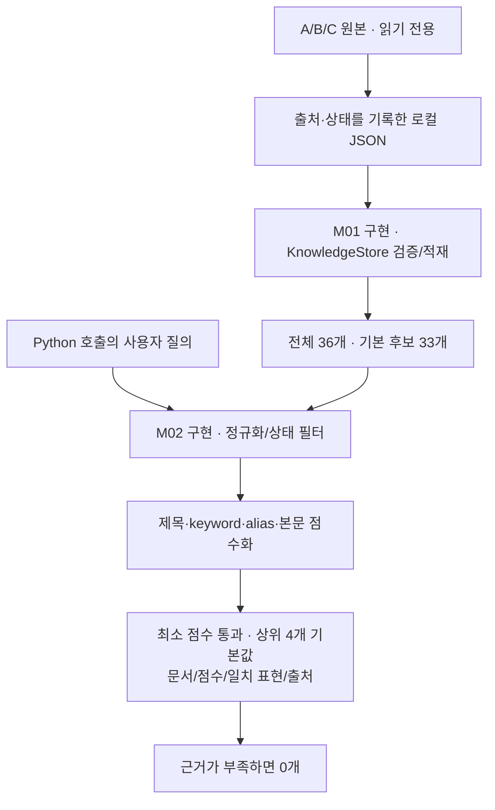
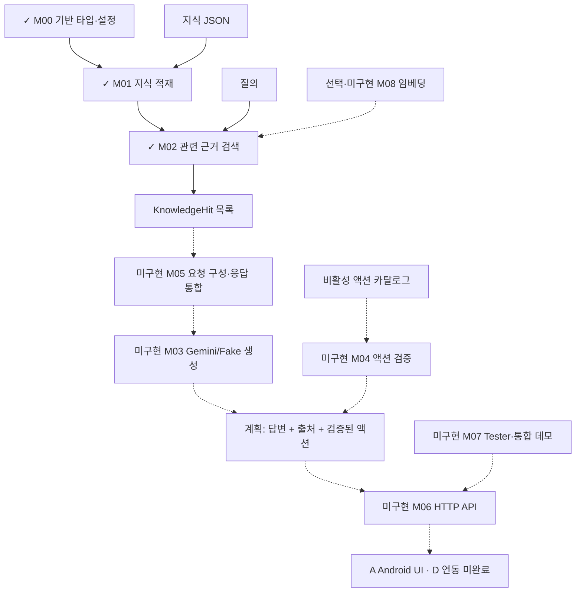

# 구현 체크리스트와 작동 구조

필수 M00~M07 중 3개 모듈의 코드가 작성되어 있다. 이는 작업량 37.5%나 제품 완성도를 뜻하지 않는다.
M08은 선택 사항이다. 아직 채팅 API/생성/화면 실행은 연결되지 않았다.

## 모듈별 상태

| 모듈 | 구현 | 검증/남은 사항 |
|---|---|---|
| M00 패키지·타입·설정 | 구현됨 | Python 3.12.10 core import/fake 확인. 패키지 빌드·설치는 미검증. 이전 테스트 제거 유지 |
| M01 지식·변환·적재 | 구현됨 | 원본 대조, C 생성, 3.12 정상 적재 36개 확인. 실패 reload 등 전체 수락은 보류 |
| M02 키워드/유의어 검색 | 구현됨 | 3.12 fixture 10/10·입력/필터/순서 경계 확인. 일반화 품질 검증은 남음 |
| M03 Gemini/Fake 어댑터 | 미구현 | 외부 API 요청·응답 처리 미연결 |
| M04 ActionRegistry | 미구현 | 4개 액션은 비활성, 실행 검증 로직 미구현 |
| M05 ChatService | 미구현 | 이력/검색 문맥/프롬프트/응답 통합 미구현 |
| M06 HTTP API | 미구현 | Android 요청/응답 경로 미연결 |
| M07 Tester·데모 | 미구현 | 사용자 테스트 항목 지시 대기 |
| M08 임베딩 | 선택, 미구현 | 정량적 검색 실패 근거 후 검토 |

## 현재 실행 가능한 경로



## 전체 계획에서 구현된 위치

실선은 현재 코드 경로, 점선은 아직 연결되지 않은 계획이다.



M02는 근거 문서 수를 제한한다. 모델의 토큰 예산·이력·최종 프롬프트 구성은 M03/M05에서 다룬다.
M01은 지식 자료를 준비하고, M01~M06 연결 후 검색 증강 생성(RAG)의 전체 경로가 된다.

## 디렉터리

```text
silver-ringo-d/
├─ pyproject.toml, .env.example, .gitignore    [기반 구성]
├─ src/silver_ringo_d/
│  ├─ __init__.py, models.py, config.py       [M00]
│  ├─ knowledge_store.py                     [M01]
│  └─ normalizer.py, retriever.py             [M02 신규]
├─ knowledge/*.json (4종)                    [M01 자료]
├─ scripts/
│  ├─ import_jib_content.py                  [M01 변환]
│  └─ validate_knowledge.py                  [M01 수동 검증 도구]
├─ tests/fixtures/retrieval_cases.json        [기존 평가 표본]
│  (test_*.py 없음, Tester 등록 없음)
└─ docs/
   ├─ M00_TEST_SELECTION.md
   ├─ M01_IMPLEMENTATION_REPORT.md
   ├─ M02_IMPLEMENTATION_REPORT.md
   └─ 07_SPRINT_TRACKER.md
```

## 환경 및 사용자 개입

- Python 3.12.10 설치/실행 확인. 현재 셸의 python은 3.11.8, py 기본값은 3.13.
  따라서 이 프로젝트에서는 py -3.12를 명시한다. 시스템 설정은 수정하지 않았다.
- 이번 승인 범위: Python 3.12 호환 확인과 M02 로컬 fixture/경계 질의 실행.
  외부 API를 호출하지 않았으며 API 키는 지금 필요하지 않다.
- Tester 항목은 후속 사용자 지시 전까지 추가하지 않는다.
- 다음 모듈은 M03. 실제 Gemini 사용 시에만 서버 환경변수 키/모델 설정이 필요하다.

자세한 가중치·제한·실행 결과는 [M02 보고](M02_IMPLEMENTATION_REPORT.md)를 참고한다.
